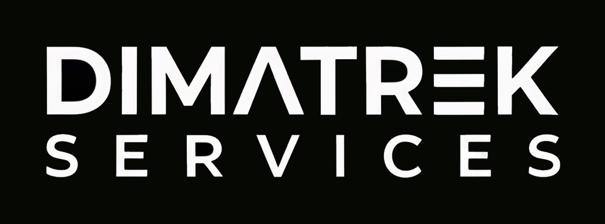
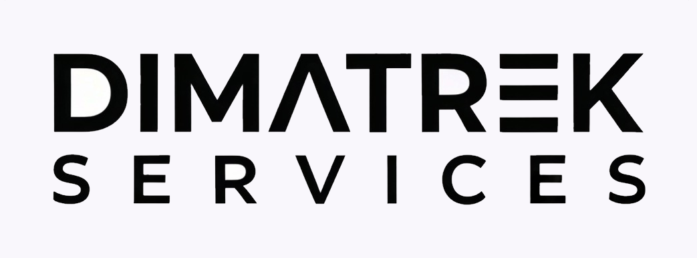
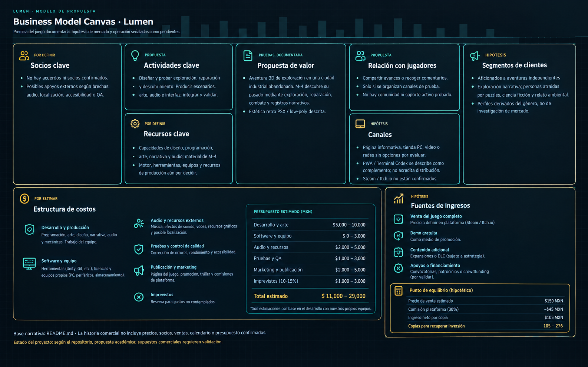
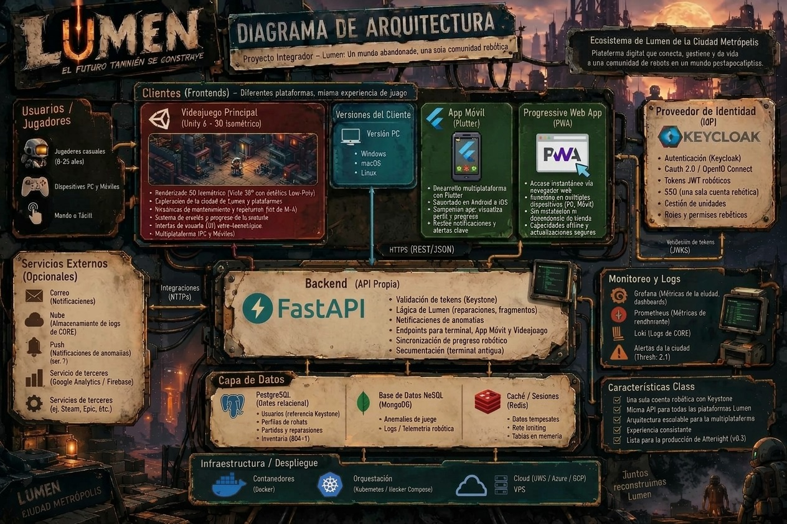
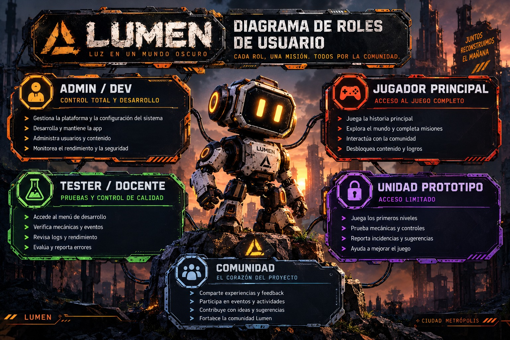
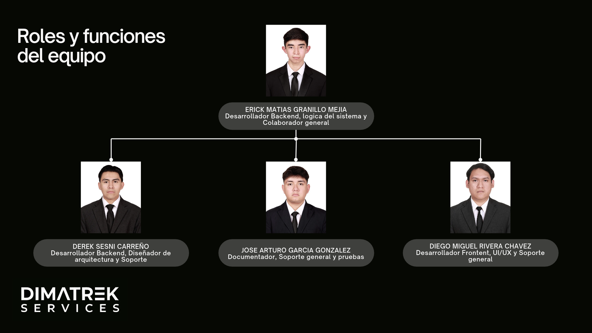

# DIMATREK

|||
|---|---|
|||
|Logo Oscuro|Logo Claro|
 

 

# Índice
- [Descripción del proyecto](#descripción-del-proyecto)
- [Problematica](#problemática)
- [Justificación](#justificación)
- [Objetivo general](#objetivo-general)
- [Objetivos específicos](#objetivos-específicos)
- [Público objetivo](#público-objetivo)
- [Alcance](#fuera-del-alcance-inicial)
- [Tecnologías utilizadas](#tecnologías-utilizadas)
- [Requerimientos funcionales](#requerimientos-funcionales)
- [Requerimientos no funcionales](#requerimientos-no-funcionales)
- [Historias de usuario](#historias-de-usuario)
- [Reglas de negocio](#reglas-de-negocio)
- [Evaluación del proyecto](#evaluación-del-proyecto)
- [Conclusión](#conclusión)
- [Modelos](#modelos)
- [Equipo de desarrollo](#equipo-de-desarrollo)
- [Organigrama](#organigrama)
- [Diagramas](#diagramas)
  - [Business Model Canvas Interactivo](#business-model-canvas-interactivo)
  - [Diagrama de Roles de Usuario](#diagrama-de-roles-de-usuario)
  - [Diagrama de Navegación de Sketches](#diagrama-de-navegación-de-sketches)

 

# LUMEN: Crónicas de una Ciudad Olvidada

  

  
  
  
  
  
  

  <strong>"Una aventura post-humana de exploración, puzzles y narrativa en las ruinas automatizadas de una metrópoli olvidada."</strong>

 

## Descripción del proyecto

LUMEN: Crónicas de una Ciudad Olvidada es un videojuego de aventura, exploración y acción en tercera dimensión que combina una ambientación de ciencia ficción con una narrativa centrada en el misterio y la supervivencia dentro de una ciudad industrial abandonada.

El jugador controla a M-4, un androide que explora las ruinas de Lumen, interactúa con personajes, descubre registros del pasado, repara mecanismos y se enfrenta a unidades hostiles. A través de la exploración y la resolución de desafíos, el jugador descubre fragmentos de la historia de la ciudad y de los acontecimientos que provocaron su abandono.

El proyecto busca ofrecer una experiencia narrativa inmersiva mediante escenarios de estilo retro, modelos tridimensionales de baja complejidad geométrica y efectos visuales inspirados en los videojuegos de la era PlayStation original.

Además del videojuego para Windows, el proyecto contempla una aplicación web progresiva (PWA), denominada Terminal Codex, que permitirá consultar información sincronizada con el juego mediante una API REST.

## Problemática

Los videojuegos de aventura pueden presentar historias lineales que limitan la exploración y el descubrimiento autónomo por parte del jugador. Asimismo, los sistemas de interacción, los combates y la resolución de obstáculos pueden resultar poco integrados cuando no existe una relación clara entre las mecánicas y la narrativa.

LUMEN propone abordar este reto mediante una experiencia que combina exploración, combate, reparación de mecanismos e investigación narrativa dentro de un entorno de ciencia ficción.

El proyecto también contempla una aplicación complementaria que permitirá extender el acceso a determinada información del juego fuera de la experiencia principal.

## Justificación

El desarrollo de LUMEN permite integrar diferentes áreas de la ingeniería de software y del desarrollo de videojuegos, como programación de mecánicas, inteligencia artificial para enemigos, diseño de interfaces, administración de estados, persistencia de datos e integración de servicios web.

La ambientación retro PSX y los escenarios industriales buscan construir una identidad visual reconocible, mientras que la exploración y los registros narrativos permiten descubrir progresivamente la historia del mundo.

La incorporación de Terminal Codex plantea una oportunidad para integrar el videojuego con tecnologías web mediante una API REST, separando las responsabilidades del cliente de escritorio, los servicios backend y la aplicación web.

El funcionamiento, la usabilidad y el rendimiento de estas soluciones deberán verificarse mediante pruebas técnicas y sesiones de evaluación con usuarios.

## Objetivos

### Objetivo general

Desarrollar un videojuego de aventura y exploración en tercera dimensión que permita al jugador investigar una ciudad industrial abandonada, resolver desafíos, enfrentarse a enemigos y descubrir su historia mediante mecánicas interactivas, narrativa ambiental y sistemas de progresión.

### Objetivos específicos

- Implementar el control y movimiento del protagonista M-4 en un entorno tridimensional.
- Diseñar escenarios que permitan explorar diferentes áreas de la ciudad de Lumen.
- Incorporar interacciones con objetos, mecanismos y personajes secundarios.
- Desarrollar mecánicas de reparación para resolver obstáculos del entorno.
- Implementar un sistema de combate contra enemigos controlados por inteligencia artificial.
- Integrar diálogos y registros narrativos que permitan descubrir información sobre el mundo del juego.
- Incorporar interfaces para consultar el inventario, el Codex y el estado de la partida.
- Implementar mecanismos de guardado local para conservar el progreso del jugador.
- Desarrollar una API REST que permita intercambiar información entre el videojuego y Terminal Codex.
- Diseñar una aplicación web progresiva para consultar la información que se encuentre disponible mediante los servicios del proyecto.
- Evaluar el rendimiento, la estabilidad, la usabilidad y la integración de los componentes.

## Público objetivo

| Público | Participación en el proyecto |
|---|---|
| Jugadores de videojuegos de aventura | Explorar el entorno, resolver desafíos y descubrir la narrativa. |
| Aficionados a la ciencia ficción | Experimentar una ambientación tecnológica y una historia de misterio. |
| Jugadores interesados en la estética retro | Disfrutar de escenarios low-poly y efectos visuales inspirados en la era PSX. |
| Usuarios de Terminal Codex | Consultar la información del juego que esté disponible mediante la aplicación complementaria. |
| Desarrolladores y evaluadores | Comprobar el funcionamiento de las mecánicas, los servicios y la integración entre componentes. |

### Fuera del alcance inicial

Salvo que el equipo decida ampliar los objetivos, se propone excluir de la primera versión:

- Modo multijugador.
- Versiones nativas para consolas.
- Sistemas de compras integradas.
- Funciones de inteligencia artificial generativa.
- Compatibilidad garantizada con todas las configuraciones de hardware.
- Funciones adicionales de Terminal Codex que no estén definidas en la API.
- Servicios en línea que no sean necesarios para las funciones previstas.

Estas exclusiones son propuestas de alcance y deberán validarse con el equipo responsable del proyecto.

## Tecnologías utilizadas

| Tecnología | Uso previsto |
|---|---|
| Unity 3D | Motor para construir el videojuego tridimensional. |
| C# | Programación de mecánicas, interacciones, estados y sistemas del juego. |
| Node.js | Entorno de ejecución del backend. |
| Express | Desarrollo de endpoints y servicios HTTP, si corresponde a la configuración del backend. |
| API REST | Comunicación entre el videojuego y los servicios web. |
| HTTPS | Protección de las comunicaciones entre componentes. |
| Terminal Codex | Aplicación web progresiva complementaria. |
| FMOD Studio | Gestión de música, efectos y audio ambiental. |
| Git y GitHub | Control de versiones y colaboración durante el desarrollo. |

Las tecnologías y sus responsabilidades deberán contrastarse con los archivos de configuración y el código actual del repositorio.

## Requerimientos funcionales

| ID | Requerimiento |
|---|---|
| RF-01 | El sistema permitirá controlar el movimiento del protagonista M-4. |
| RF-02 | El jugador podrá explorar los escenarios disponibles. |
| RF-03 | El sistema permitirá interactuar con objetos y mecanismos habilitados. |
| RF-04 | El jugador podrá reparar los mecanismos definidos por el juego. |
| RF-05 | El sistema permitirá combatir contra enemigos. |
| RF-06 | Los enemigos ejecutarán los comportamientos definidos para cada tipo de unidad. |
| RF-07 | El jugador podrá interactuar con personajes secundarios. |
| RF-08 | El sistema permitirá consultar diálogos y registros narrativos. |
| RF-09 | El jugador podrá consultar las interfaces de inventario y Codex disponibles. |
| RF-10 | El sistema permitirá guardar y recuperar el progreso local. |
| RF-11 | El videojuego podrá intercambiar información con el backend mediante la API REST. |
| RF-12 | Terminal Codex podrá consultar y mostrar la información expuesta por la API. |
| RF-13 | El sistema reproducirá los recursos de audio configurados. |
| RF-14 | El jugador podrá desactivar el efecto CRT cuando la opción esté disponible. |

## Requerimientos no funcionales

| ID | Requerimiento |
|---|---|
| RNF-01 | El videojuego deberá buscar un objetivo de rendimiento de 60 FPS en equipos compatibles. |
| RNF-02 | La versión de escritorio deberá orientarse a Windows 10 y Windows 11 de 64 bits, sujeto a validación. |
| RNF-03 | El código deberá organizarse de forma modular para facilitar su mantenimiento. |
| RNF-04 | Las comunicaciones con el backend deberán utilizar HTTPS en producción. |
| RNF-05 | El sistema deberá validar los datos recibidos por la API. |
| RNF-06 | Los errores de comunicación deberán gestionarse sin bloquear innecesariamente las funciones locales. |
| RNF-07 | El guardado local deberá conservar de manera coherente el progreso que se haya definido como persistente. |
| RNF-08 | La interfaz deberá proporcionar información comprensible sobre las acciones y los estados del juego. |
| RNF-09 | Los recursos audiovisuales deberán mantener coherencia con la dirección artística definida. |
| RNF-10 | La API y Terminal Codex deberán utilizar contratos de comunicación documentados. |
| RNF-11 | Las credenciales y los secretos de configuración no deberán exponerse en el repositorio. |
| RNF-12 | Los componentes deberán someterse a pruebas de funcionamiento, integración y compatibilidad. |

## Historias de usuario

### HU-01. Controlar al protagonista

Como jugador, quiero controlar a M-4 mediante el teclado, para explorar los escenarios y avanzar en la aventura.

**Criterios de aceptación:**

- El personaje responde a los controles configurados.
- El movimiento respeta los límites del escenario.
- Las acciones de movimiento no bloquean las interacciones disponibles.

### HU-02. Explorar la ciudad

Como jugador, quiero explorar las ruinas de Lumen, para descubrir lugares, objetos e información narrativa.

**Criterios de aceptación:**

- El jugador puede recorrer las áreas habilitadas.
- Los objetos interactivos pueden utilizarse cuando se cumplen sus condiciones.
- Los elementos narrativos disponibles pueden consultarse.

### HU-03. Reparar mecanismos

Como jugador, quiero reparar circuitos y mecanismos, para superar obstáculos y avanzar.

**Criterios de aceptación:**

- El sistema identifica los mecanismos reparables.
- La interacción respeta las condiciones definidas.
- Una reparación válida actualiza el estado correspondiente.

### HU-04. Enfrentar enemigos

Como jugador, quiero combatir y esquivar ataques, para sobrevivir a los enfrentamientos.

**Criterios de aceptación:**

- Las acciones de combate disponibles responden a los controles.
- Los enemigos ejecutan sus comportamientos programados.
- El resultado del enfrentamiento actualiza el estado del juego cuando corresponda.

### HU-05. Descubrir la narrativa

Como jugador, quiero consultar diálogos y registros, para comprender la historia de Lumen.

**Criterios de aceptación:**

- Los diálogos se muestran cuando se inicia una interacción válida.
- Los registros disponibles pueden consultarse.
- El contenido mostrado corresponde a los datos definidos por el juego.

### HU-06. Guardar el progreso

Como jugador, quiero conservar mi progreso, para continuar la partida posteriormente.

**Criterios de aceptación:**

- El sistema guarda el estado definido para la partida.
- Los datos pueden recuperarse al reiniciar.
- Los errores de guardado se notifican correctamente.

### HU-07. Consultar información en Terminal Codex

Como usuario de Terminal Codex, quiero consultar la información sincronizada con el videojuego, para acceder a los registros disponibles desde una aplicación web.

**Criterios de aceptación:**

- La aplicación consulta los endpoints definidos.
- La información recibida se muestra correctamente.
- Los errores de comunicación se presentan de manera comprensible.

### HU-08. Ajustar los efectos gráficos

Como jugador, quiero desactivar el efecto CRT, para adaptar la experiencia a las capacidades de mi equipo.

**Criterios de aceptación:**

- La opción de configuración está disponible.
- El efecto deja de aplicarse cuando se desactiva.
- Las demás funciones del videojuego продолжают operando.

## Reglas de negocio

| ID | Regla |
|---|---|
| RN-01 | M-4 será el protagonista controlado directamente por el jugador. |
| RN-02 | Las interacciones solo podrán ejecutarse cuando se cumplan las condiciones definidas para cada objeto o personaje. |
| RN-03 | Un mecanismo solo se considerará reparado cuando la operación se complete correctamente. |
| RN-04 | Las acciones de combate deberán respetar las reglas de estado y comportamiento establecidas para el jugador y los enemigos. |
| RN-05 | Los registros narrativos se mostrarán según su disponibilidad en el juego. |
| RN-06 | El progreso deberá actualizarse de acuerdo con los eventos y objetivos definidos. |
| RN-07 | Los datos guardados deberán representar un estado válido de la partida. |
| RN-08 | La sincronización deberá limitarse a la información definida por los contratos de la API. |
| RN-09 | Un error de comunicación no deberá notificarse como una sincronización exitosa. |
| RN-10 | Las funciones locales que no dependan de servicios remotos deberán seguir disponibles sin conexión. |
| RN-11 | La API deberá validar las solicitudes antes de procesar operaciones que modifiquen datos. |
| RN-12 | Los datos protegidos deberán estar disponibles únicamente para los componentes o usuarios autorizados. |

## Evaluación del proyecto

Para comprobar el funcionamiento de LUMEN se propone evaluar los siguientes aspectos:

- Mecánicas: verificar el movimiento, las interacciones, las reparaciones y el combate.
- Inteligencia artificial: comprobar que los enemigos ejecuten los comportamientos previstos.
- Narrativa: verificar la presentación de diálogos y registros.
- Persistencia: comprobar que el progreso se guarde y recupere correctamente.
- Integración: verificar el intercambio de información entre el videojuego, la API y Terminal Codex.
- Rendimiento: medir los FPS, los tiempos de carga y el consumo de recursos en equipos de prueba.
- Usabilidad: evaluar la claridad de los controles, las interfaces y las indicaciones del sistema.
- Compatibilidad: probar el funcionamiento en los entornos de Windows previstos.

Los resultados de las pruebas permitirán identificar errores y determinar si los requisitos de calidad se cumplen.

## Conclusión

LUMEN: Crónicas de una Ciudad Olvidada es un proyecto que integra el desarrollo de videojuegos tridimensionales con mecánicas de exploración, combate, reparación e investigación narrativa. Su propuesta combina una identidad visual retro con una arquitectura que contempla la comunicación entre una aplicación de escritorio y una aplicación web complementaria.

La documentación establece una base para definir los objetivos, el alcance, los requisitos funcionales y no funcionales, las historias de usuario y las reglas de negocio del proyecto.

Antes de utilizarla como especificación definitiva, se deberán verificar las funcionalidades implementadas, los endpoints disponibles, los datos sincronizados y las características técnicas reales de la versión actual.

## Modelos

### Canvas del proyecto

  

### Diagrama de arquitectura

  

### Diagrama de roles

  

## Equipo de desarrollo

| Integrante | Rol | Principales responsabilidades | Perfil |
|---|---|---|---|
| Erick Matias | Project Manager / Compositor musical secundario | Gestión del backlog en Jira y composición musical en LMMS/Cakewalk, diseño de SFX y mezcla en FMOD. | [@EMATIAS](https://github.com/EMATIAS230045) |
| Derek Sesni | Lead Programmer / Game Designer | Arquitectura en C#, mecánicas de juego, integración de FMOD y sincronización con la PWA. | [@DevFntxy](https://github.com/DevFntxy) |
| Diego Rivera | Artista 2D / 3D / Compositor musical principal | Modelado low-poly en Blender, animaciones, texturizado PSX, interfaz visual y composición musical en LMMS/Cakewalk, diseño de SFX y mezcla en FMOD. | [@DiegoMiguel04](https://github.com/DiegoMiguel04) |
| José García | Documentador principal / Tester QA | Creación de documentos guía para el desarrollo, pruebas de calidad y control de riesgos. | [@ppyo1234](https://github.com/ppyo1234) |

## Organigrama

## Diagramas

### Business Model Canvas Interactivo
- **Descripción:** El estudiante realizará un prompt para solicitar el modelo business canvas de su proyecto integrador utilizando Achify.
- **Estatus:** ✅ Completada
- **Enlace:** [Ver Canvas Interactivo](https://devfntxy.github.io/Lumen/models/canvas/proyecto_lumen_business_model_canvas.html)

---

### Diagrama de Roles de Usuario
- **Descripción:** El estudiante realizará un prompt para generar un diagrama interactivo de roles de usuario y permisos de su proyecto integrador.
- **Estatus:** ✅ Completada
- **Enlace:** [Ver Diagrama de Roles](https://devfntxy.github.io/Lumen/models/role/AFTERLIGHT%20%C2%B7%20Diagrama%20de%20roles%20y%20permisos.html)

---

### Diagrama de Navegación de Sketches
- **Descripción:** El estudiante realizará un prompt para generar un diagrama interactivo de los sketches de su proyecto integrador.
- **Estatus:** ⏳ Realizando
- **Enlace:** [Ver Diagrama de Sketches](https://devfntxy.github.io/Lumen/models/diagrama%20de%20frecuencia/DiagramaDeSketchesLumen.html)
